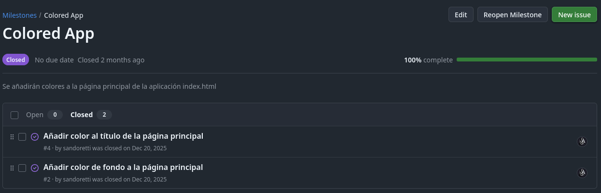
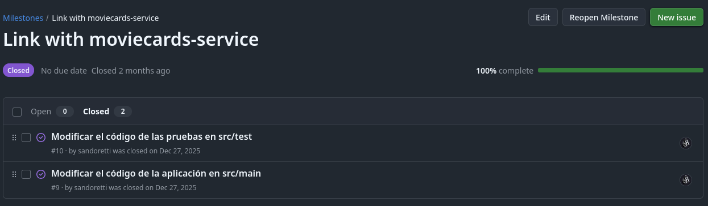
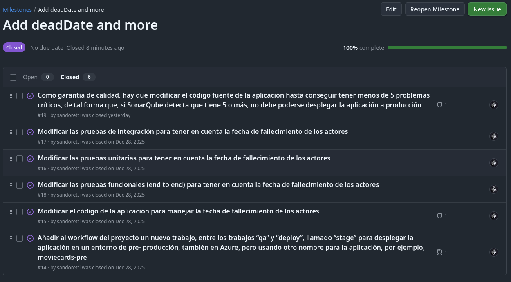
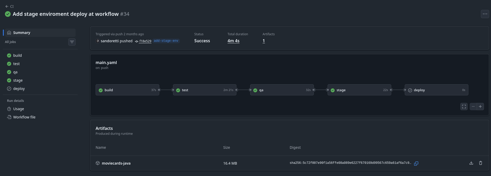
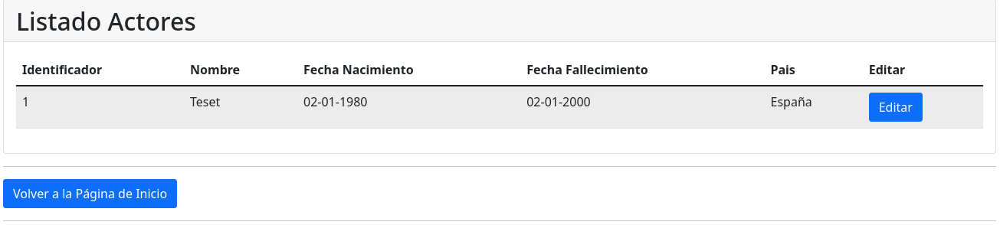
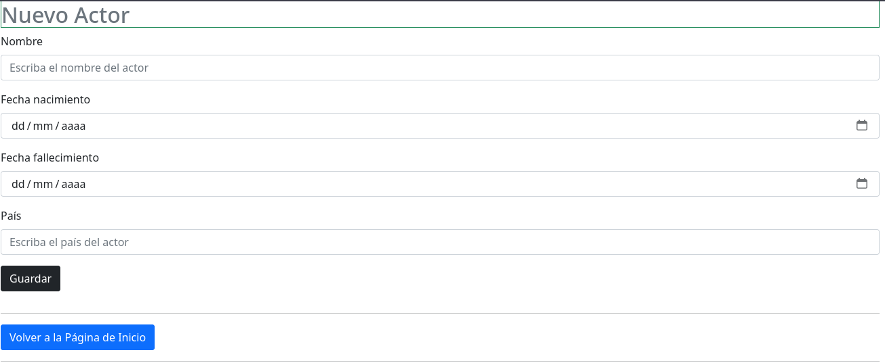
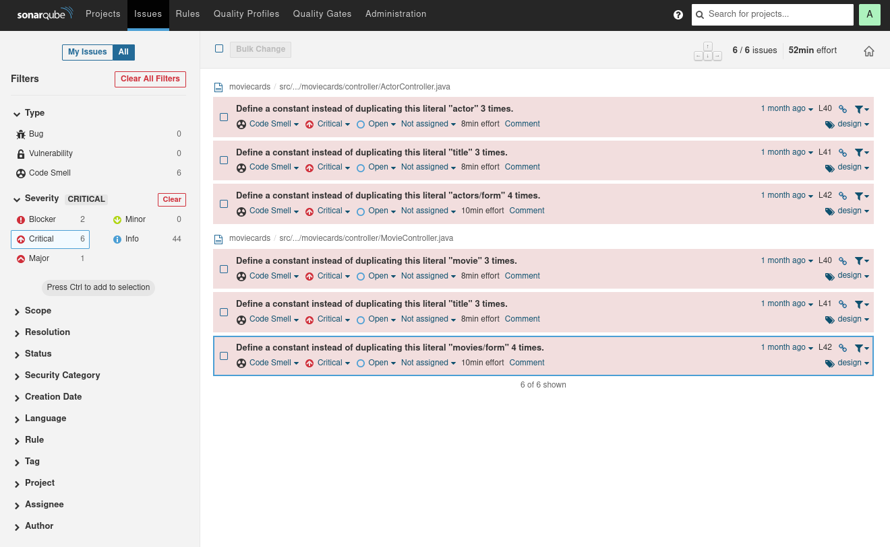
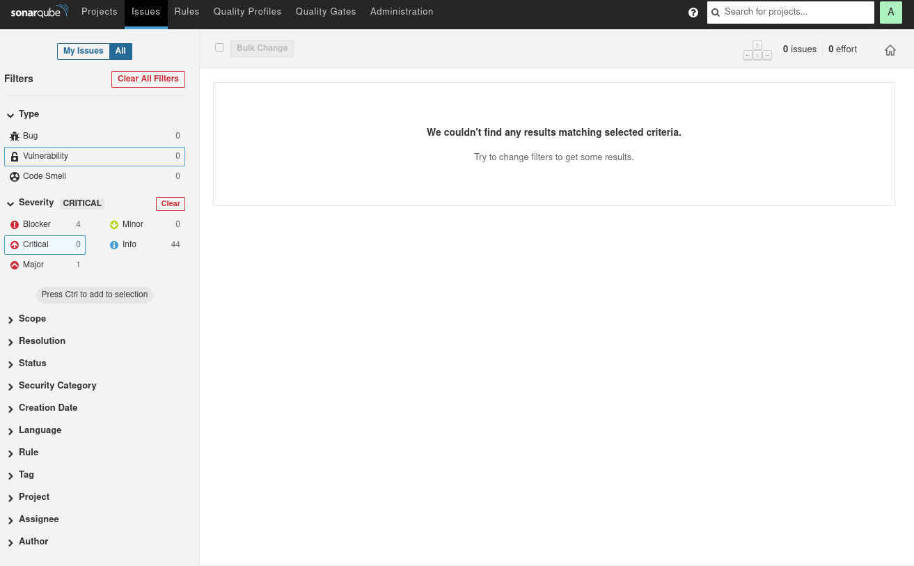
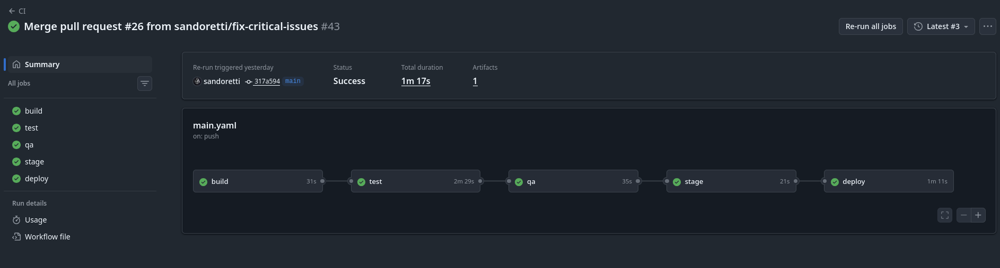

# Documentación — Trabajo Final ICDA
**App producción:** https://moviecards-sandoval.azurewebsites.net \
**App pre-producción:** https://moviecards-pre-sandoval.azurewebsites.net

---

## Punto 1 — Práctica Tema 5: aplicación `moviecards` base

Se parte del código fuente de la práctica del tema 5. El commit inicial en este repositorio incluye ya toda la estructura de la práctica:

- **Commit:** `a89cb8f` — *Init commit* (código base completo)

A continuación se configuró el pipeline de CI/CD en `.github/workflows/main.yaml` con los siguientes trabajos: `build → test → qa → deploy`.

| Trabajo  | Descripción                                           | Commits relevantes                                           |
|----------|-------------------------------------------------------|--------------------------------------------------------------|
| `build`  | Compila y empaqueta el `.jar` con Maven               | `9bce05a`, `f2849af`                                         |
| `test`   | Ejecuta pruebas unitarias, integración y E2E          | `15adc08`, `f352457`–`77f172c`–`37d1af6`–`851aa8a`–`3c7f07b` |
| `qa`     | Análisis SonarQube en runner self-hosted              | `24ff57a`                                                    |
| `deploy` | Despliegue en Azure App Service con aprobación manual | `b5a2713`, `e3e6ce9`, `488c4f4`                              |

La app quedó operativa en Azure. Se añadieron también las mejoras visuales mediante pull requests de la **Milestone: Colored App** 
que ejecutaron los jobs mediante confirmación.

- **PR #5** — fondo de color en página principal → commit `90f09f1`
- **PR #7** — color de título → commits `4eb0a12`, `b43aa17`

[](https://github.com/sandoretti/moviecard/milestone/1?closed=1)
---

## Punto 3 — Nueva versión de `moviecards` integrando `moviecards-service`

Se crea un **Milestone: Link with moviecards-service**  con los siguientes issues:

- **Issue 3.1** — Modificar el código de la aplicación en `src/main`
- **Issue 3.2** — Modificar el código de las pruebas en `src/test`

[](https://github.com/sandoretti/moviecard/milestone/2?closed=1)

Todos los cambios se realizaron en la rama `modify-main` y se integraron en `main` mediante **PR #11** (commit de merge `8f42020`).

### 3.1 — Cambios en `src/main` (Issue 3.1)

**Commit:** `bd7554e` — *Modified main to integrate with moviecards-service*

Archivos modificados:

| Archivo                                                 | Cambio principal                                                            |
|---------------------------------------------------------|-----------------------------------------------------------------------------|
| `src/main/java/.../MovieCardsApplication.java`          | Añadido bean `RestTemplate`                                                 |
| `src/main/java/.../service/actor/ActorServiceImpl.java` | Sustituido `ActorJPA` por `RestTemplate`; llamadas REST al servicio         |
| `src/main/java/.../service/movie/MovieServiceImpl.java` | Sustituido `MovieJPA` por `RestTemplate`; llamadas REST al servicio         |
| `src/main/java/.../model/Actor.java`                    | Eliminadas anotaciones JPA (la persistencia la gestiona el servicio)        |
| `src/main/java/.../model/Movie.java`                    | Ídem                                                                        |
| `src/main/resources/application.properties`             | URL del servicio inyectada vía variable de entorno `MOVIECARDS_SERVICE_URL` |

La URL del servicio se externaliza para poder cambiarla sin tocar el código:

```properties
# application.properties
moviecards.url=${MOVIECARDS_SERVICE_URL:http://localhost:8081}
```

Commit adicional: `736d4ec` — *Use MOVIECARDS_SERVICE_URL as service URL* (refactor para usar `@Value` en lugar de URL hardcodeada).

### 3.2 — Cambios en `src/test` (Issue 3.2)

**Commit:** `32ba16b` — *Modified test to integrate with moviecards-service*

- Eliminadas las pruebas de integración con repositorios JPA (`ActorJPAIT`, `MovieJPAIT`), ya que la persistencia ha pasado al servicio externo.
- Adaptados `ActorServiceImplTest` y `MovieServiceImplTest`: se mockea `RestTemplate` en lugar de `ActorJPA`/`MovieJPA`.

---

## Punto 5 — Nueva versión con `deadDate`

Se crea un **Milestone: Add deadDate and more** con los siguientes issues: 5.1 a 5.6.

[](https://github.com/sandoretti/moviecard/milestone/3?closed=1)

### 5.1 — Entorno de pre-producción `stage` (Issue 5.1)

**Rama:** `add-stage-env` → **PR #21** (merge `4e43ead`) \
**Commit:** `f18e529` — *Add stage environment deploy at workflow*

Se añadió el trabajo `stage` en `.github/workflows/main.yaml`, entre `qa` y `deploy`, que despliega automáticamente en el entorno de pre-producción:

```yaml
# .github/workflows/main.yaml
stage:
  runs-on: ubuntu-latest
  needs: qa
  steps:
    - uses: actions/download-artifact@v4
      with:
        name: moviecards-java
    - uses: azure/webapps-deploy@v3
      with:
        app-name: 'moviecards-pre-sandoval'
        slot-name: 'Production'
        package: '*.jar'
        publish-profile: ${{ secrets.AZUREAPPSERVICE_PUBLISHPROFILE_EB7A804F3ACE4907953B4A33B76F46C2 }}
```

El pipeline completo queda: `build → test → qa → stage → deploy`.

[](https://github.com/sandoretti/moviecard/actions/runs/20545854182)

### 5.2 — Código de `deadDate` en frontend (Issue 5.2)

**Rama:** `add-deadDate` → **PR #23** (merge `9c8d4a0`) \
**Commit:** `bae1600` — *Add deadDate at actor and its frontend pages*

Archivos modificados:

| Archivo                                         | Cambio                                                         |
|-------------------------------------------------|----------------------------------------------------------------|
| `src/main/java/.../model/Actor.java`            | Campo `deadDate` con `@DateTimeFormat(pattern = "yyyy-MM-dd")` |
| `src/main/resources/templates/actors/form.html` | Campo de formulario para introducir la fecha de fallecimiento  |
| `src/main/resources/templates/actors/list.html` | Nueva columna "Fecha de fallecimiento" en el listado           |

[](https://moviecards-sandoval.azurewebsites.net/actors)

[](https://moviecards-sandoval.azurewebsites.net/actors/new)

### 5.3 — Pruebas unitarias con `deadDate` (Issue 5.3)

**Commit:** `3960820` — *Modify unit tests to add deadDate*

Archivo modificado:
- `src/test/java/.../unittest/model/ActorTest.java` — añadidos asserts sobre el campo `deadDate`.

### 5.4 — Pruebas de integración con `deadDate` (Issue 5.4)

**Commit:** `81d87a9` — *Create integrated tests again to mock external REST API and add deadDate*

Archivos añadidos (pruebas de integración que mockean `RestTemplate`):
- `src/test/java/.../integrationtest/service/ActorServiceIT.java`
- `src/test/java/.../integrationtest/service/MovieServiceIT.java`

### 5.5 — Pruebas E2E con `deadDate` (Issue 5.5)

**Commit:** `391707e` — *Modify E2E tests to add deadDate*

Archivo modificado:
- `src/test/java/.../endtoendtest/ActorE2ETest.java` — verificación del campo `deadDate` en el formulario y el listado.

> Commit previo `37f5c7d` (*Workaround to skip new deadDate tests errors*) fue necesario de forma temporal hasta que el campo estuvo disponible en el servicio.

### 5.6 — Calidad: reducir issues críticos en SonarQube (Issue 5.6)
Mirando que habia fallado en los apartados anteriores, si nos metemos al SonarQube, nos salen los siguientes issues críticos. Sabiendo que el pipeline está configurado para bloquear el despliegue si SonarQube detecta 5 o más issues críticos (`sonar.qualitygate.wait=true`), se han visto estos errores y se han resuelto.



**Rama:** `fix-critical-issues` → **PR #26** (merge `317a594`)\
**Commit:** `786a97e` — *Fix critical issues to prevent duplication using constants*

Archivos modificados:
- `src/main/java/.../controller/ActorController.java` — sustituidas cadenas literales duplicadas por constantes.
- `src/main/java/.../controller/MovieController.java` — sustituidas cadenas literales duplicadas por constantes.



Con esto llegamos a 0 issues críticos, lo que permite el despliegue sin bloqueos.

[](https://github.com/sandoretti/moviecard/actions/runs/22225743730)

---

## Punto 6 — Documentación

Este fichero `documentacion.md` en la raíz del repositorio constituye la documentación del trabajo realizado.

El pipeline CI/CD final del repositorio `moviecard` sigue el flujo:

```
push → build → test → qa → stage → deploy (aprobación manual, solo rama main)
```
